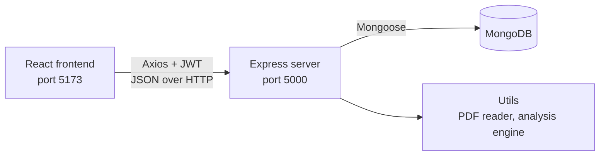

# LabLens

**Understand your blood reports, finally.**

LabLens is a full-stack web app (MERN) that turns a lab report into something a normal person can read. A patient uploads a blood test PDF or photo, LabLens extracts every biomarker, compares each value with its normal range, and shows a health score, trends over time, and plain-language advice. Patients can also give their doctor access, so the doctor can review the same reports.

> LabLens is a learning project. It is not a medical device and does not replace advice from a doctor.

---

## Table of contents

- [Features](#features)
- [Tech stack](#tech-stack)
- [How it works](#how-it-works)
- [Project structure](#project-structure)
- [Getting started](#getting-started)
- [Demo accounts and sample reports](#demo-accounts-and-sample-reports)
- [API reference](#api-reference)
- [Data models](#data-models)
- [Security](#security)

---

## Features

**For patients**

- Upload a lab report as a PDF or image (up to 10 MB). Text is read directly from normal PDFs, and scanned files fall back to OCR.
- Automatic biomarker extraction, with an editable review step before saving.
- Each value is marked normal, low or high, with a severity level.
- A health score from 0 to 100 for every report.
- A dashboard of all reports, a detailed analysis page for each one, and a compare view.
- Trend charts that follow a biomarker across reports.
- A health advisory based on the latest report.
- A biomarker guide with normal ranges for your age and sex.
- Onboarding and profile (age, sex, height, weight, blood group, lifestyle).

**For doctors**

- A unique doctor code (for example `DOC-A1B2C3`) that patients can use to send a link request.
- Accept or revoke link requests.
- A dashboard of linked patients, with each patient's reports and trends.
- Access is allowed only while the link between doctor and patient is active.

---

## Tech stack

| Layer | Technology |
|---|---|
| Frontend | React 18, Vite, React Router, Axios, Recharts, Lucide icons |
| Backend | Node.js, Express |
| Database | MongoDB with Mongoose (in-memory MongoDB for development) |
| Auth | JSON Web Tokens (JWT), bcrypt password hashing |
| File handling | Multer (uploads), pdf-parse (PDF text), Tesseract.js (OCR) |
| Protection | express-rate-limit, CORS restricted to the frontend |

---

## How it works



1. The React app sends requests through one configured Axios instance (`client/src/api/axios.js`), which attaches the JWT to every call.
2. On the server, each request passes through the route, then middleware (`protect`, `requireRole`, upload handling), then a controller.
3. Controllers use Mongoose models to read and write MongoDB, and use the helpers in `server/utils` to parse reports and calculate results.
4. The server returns JSON and React renders it.

**Saving a report:** the file is uploaded to `POST /api/reports/upload-pdf`, the text is extracted and matched against the known biomarker list, and the user reviews the values. `POST /api/reports` then saves the report. The server recalculates every status, severity and the health score itself instead of trusting the browser.

**Health score:** start at 100 and subtract points for each abnormal value (marked 15, moderate 10, mild 5), multiplied by a weight for the body system. The result is kept between 0 and 100.

---

## Project structure

```text
LabLens/
├── client/                      React frontend (Vite)
│   └── src/
│       ├── api/axios.js         Axios instance, token and 401 handling
│       ├── context/             AuthContext (login state shared by the app)
│       ├── components/          Navbar, ProtectedRoute, landing sections
│       ├── pages/               One file per screen
│       └── App.jsx              Routes
├── server/                      Express backend
│   ├── server.js                App entry point
│   ├── config/db.js             MongoDB connection and seeding
│   ├── routes/                  URL to controller mapping
│   ├── controllers/             Request logic
│   ├── models/                  Mongoose schemas
│   ├── middleware/              Auth, uploads, error handling
│   ├── utils/                   PDF parser, analysis engine, access control
│   ├── seed.js, seedData.js     Demo data
│   └── tests/unit.test.js       Unit tests
├── sample_*.pdf                 Sample lab reports for testing
└── FUTURE_CHANGES_AND_ROADMAP.md
```

---

## Getting started

### Prerequisites

- Node.js v18 or newer
- npm
- A MongoDB connection string (optional). Without one, the server uses a temporary in-memory database.

### 1. Clone the repository

```bash
git clone https://github.com/kanishkasahal24/LabLens.git
cd LabLens
```

### 2. Set up the server

```bash
cd server
npm install
cp .env.example .env
npm run dev
```

The API runs at `http://localhost:5000`.

### 3. Set up the client

Open a second terminal:

```bash
cd client
npm install
cp .env.example .env
npm run dev
```

### 4. Open the app

Go to `http://localhost:5173`.

> If `MONGODB_URI` is empty, LabLens starts an in-memory MongoDB. Everything works, but **all data is erased when the server restarts**. The demo accounts and biomarker references are created again on each start. To keep your data, set `MONGODB_URI` (for example a free MongoDB Atlas cluster).

---

## Demo accounts and sample reports

| Role | Email | Password |
|---|---|---|
| Patient | `john@example.com` | `Password123!` |
| Doctor | `dr.jenkins@lablens.com` | `Password123!` |

The repository includes three sample lab reports you can upload on the **Add report** page:

- `sample_blood_report.pdf`
- `sample_cbc_thyroid_report.pdf`
- `sample_metabolic_diabetes_report.pdf`

---

## API reference

All routes are under `/api`. Except for register and login, every route needs the header `Authorization: Bearer <token>`.

### Auth

| Method | Endpoint | Description |
|---|---|---|
| POST | `/auth/register` | Create a patient or doctor account |
| POST | `/auth/login` | Log in and receive a token |
| GET | `/auth/me` | Get the current user from the token |

### Profile

| Method | Endpoint | Description |
|---|---|---|
| GET | `/profile` | Get the user's profile |
| PUT | `/profile` | Create or update the profile |

### Reports

| Method | Endpoint | Role | Description |
|---|---|---|---|
| GET | `/reports` | Patient | List the patient's reports |
| GET | `/reports/:id/analysis` | Patient, linked doctor | Report with score breakdown and advice |
| GET | `/reports/advisory/latest` | Patient | Advice based on the latest report |
| GET | `/reports/trends/all` | Patient | Biomarker values over time |
| GET | `/reports/references/all` | Any | Biomarker list with normal ranges |
| POST | `/reports/upload-pdf` | Patient | Upload a PDF or image and extract biomarkers |
| POST | `/reports` | Patient | Save a report |
| DELETE | `/reports/:id` | Patient | Delete a report |

### Doctor and patient links

| Method | Endpoint | Description |
|---|---|---|
| GET | `/doctors/:code` | Look up a doctor by code |
| POST | `/links` | Patient requests a link to a doctor |
| GET | `/links` | List the user's links |
| PATCH | `/links/:id` | Doctor accepts or revokes a request |
| DELETE | `/links/:id` | Remove a link |

### Doctor view of patients (doctor only)

| Method | Endpoint | Description |
|---|---|---|
| GET | `/patients` | List linked patients |
| GET | `/patients/:id` | One patient's details |
| GET | `/patients/:id/reports` | That patient's reports |
| GET | `/patients/:id/trends` | That patient's trends |

---

## Data models

| Model | Purpose |
|---|---|
| `User` | Account: name, email, hashed password, role (`patient` or `doctor`), doctor code |
| `PatientProfile` | Date of birth, sex, height, weight, blood group, lifestyle |
| `DoctorProfile` | License number, specialisation, clinic |
| `Report` | Lab details, health score, overall status, and embedded biomarker parameters |
| `Link` | Doctor-patient permission with status `pending`, `active` or `revoked` |
| `ParameterReference` | Master list of biomarkers, aliases, units, normal ranges and advice |

---

## Security

- Passwords are hashed with bcrypt and never stored in plain text.
- Login returns a signed JWT that expires after 7 days.
- Role checks (`requireRole`) separate patient and doctor routes.
- A doctor can open a patient's data only through an **active** link.
- Login and register are rate limited to 20 requests per 15 minutes.
- Uploads accept only PDFs and images, up to 10 MB.
- CORS allows only the configured frontend address.
